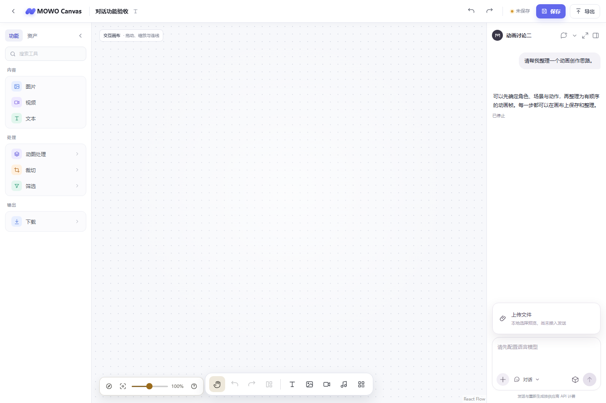
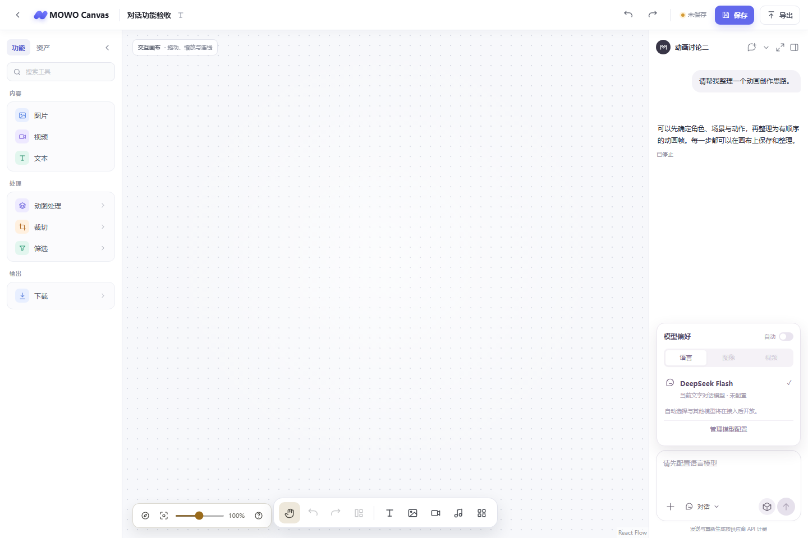

# 对话输入操作栏 V01

状态：**当前最新候选，先完成 UI，待用户体验验收**。

## 当前布局

输入框下方从左到右为：加号功能菜单、模式选择、模型偏好、圆形发送/停止按钮。弹层向上打开，保持在当前对话栏内；窄侧栏和放大状态使用同一个组件。

## 已确认范围

首版加号菜单只有“上传文件”。@ 画布引用、技能、连接器及其他功能等有明确用途后再加入。

本轮仍按先 UI 后能力实施。文件选择目前只显示本机文件名和大小，可移除；不读取正文、不传到服务端、不进入资产库或聊天、不发往模型。重复选择同名、同大小和同修改时间的文件不重复显示；关闭页面或切换会话后清除预览。

带有预览文件时显示说明并阻止发送；移除后恢复正常文字对话，避免静默丢掉文件却继续发送文字。

## 当前候选交互

- 模式菜单当前为“对话”；图像、视频显示未接入并禁用。没有 Agent Plus 或订阅入口。
- 模型偏好单独展示模型类型、自动选择开关位置和当前 DeepSeek Flash。当前只有一个语言模型，自动选择及图像/视频页签禁用，不改变真实供应商配置。
- “管理模型配置”打开已有配置说明窗口；设置仍不在浏览器展示密钥。
- 发送按钮为空输入或不可发送时禁用；生成期间变成停止按钮。Enter 发送、Shift+Enter 换行、中文输入法处理保留。
- 菜单可通过再次点击、点击外部或 Escape 关闭。
- 模式按钮使用固定尺寸 SVG 箭头，与图标和文字垂直居中；菜单展开时箭头向上旋转，不依赖字体字符基线。

## 验证

2026-11-06：类型检查、Lint、Webpack 生产构建通过。隔离浏览器验证仅有一个功能菜单项、模式占位禁用、模型偏好、文件选择/显示/移除与发送阻挡；同时通过原聊天停止、历史恢复及提问卡片预览回归。运行和消息数量没有增加；本轮未发起模型调用。
