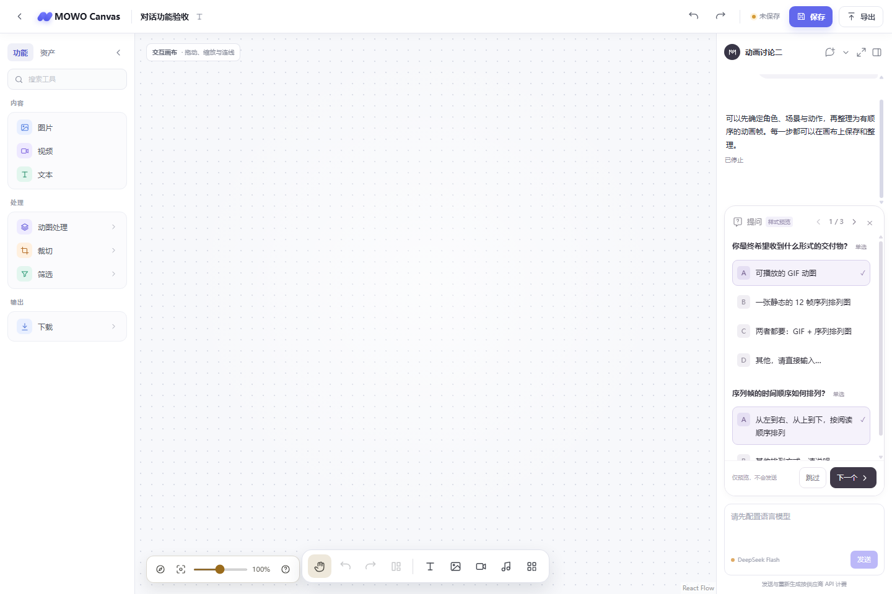

# 提问卡片 V01

状态：**当前最新候选，已实现 UI 预览，具体样式待用户验收**。本主题只保留这一份当前样式。

## 目标与入口

先完成需求确认卡片的视觉与本地交互，后续再讨论助手何时追问。当前入口是画布右侧对话栏的 **Logo 菜单 → 提问卡片样式预览**。

预览使用固定示例，不是助手实际发起的提问，也不属于聊天记录。关闭或切换会话后清除本地预览状态；不会保存为任务、发送给模型或产生 API 费用。

## 当前候选交互

- 卡片放在输入框上方，圆角白底；标题为“提问”，同时标明样式预览。
- 顶部显示页码、上一页/下一页和关闭；选项使用 A/B/C 字母标记，选中后显示淡紫底色与勾选反馈。
- 支持单选、多选与选中“其他”后的自定义输入；返回上一页时保留选择。
- 问题内容独立滚动，底部跳过与下一步保持可见；当前页有未回答问题或空的自定义说明时，可跳过，不能直接确认下一步。
- 顶部分页用于自由检查各页；“跳过”允许不作答前往下一页，已选择内容仍保留。
- 最后一页的“完成预览”只显示本地选择摘要，可重新预览或关闭。正式组件预留完成回调，当前未接任何模型或业务接口。

示例中的 GIF、排列图等文字只用于展示问题与选项样式，不构成产品任务或新增模型能力。

## 验证

2026-11-06：TypeScript、Lint、Webpack 生产构建通过。隔离 Chromium 浏览器验证单选、多选、自定义输入、跨页保留、跳过、摘要、重开与关闭；默认窄侧栏无横向溢出，底部操作与输入框分离。前后 AI 运行和消息数量一致，没有新的模型调用。
